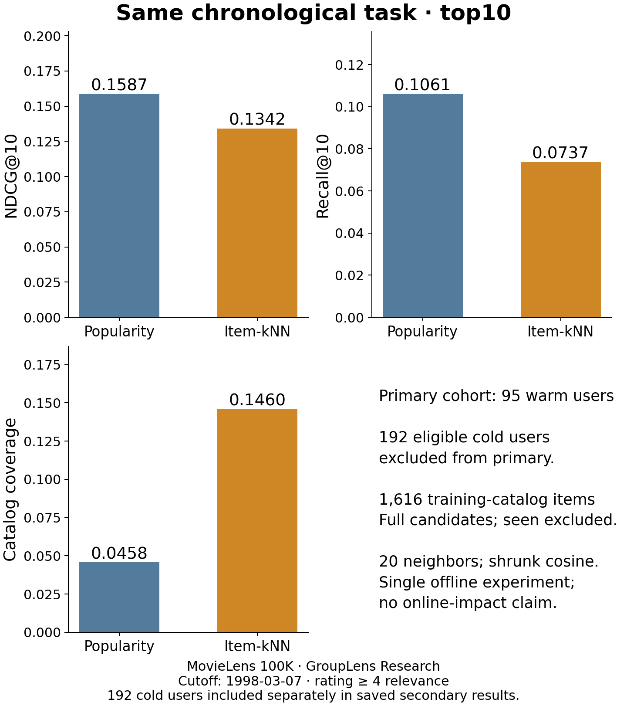

# Recommendation Explorer

A local workbench for recommender developers and product analysts: select liked
and seen items, compare a learned item-neighborhood ranking with popularity,
inspect contributing history, then export the exact results as JSON or CSV.
No sign-in, paid key, telemetry or external inference service. This is a small
local research/demo app, not a hosted production recommendation service. Desktop
browser workflows and actual downloads were verified. Mobile rendering could not
be verified through the connected browser, so mobile support is not claimed.

## Run

Python3.12 was checked; NumPy1.26.4, SciPy1.17.1, Matplotlib3.10.0.

```sh
python -m venv .venv
# Activate .venv using your platform's activation command.
python -m pip install -r requirements.txt
python -m unittest -v
python app.py
```

Open http://127.0.0.1:8765. The default is an **authored synthetic catalog**, not
MovieLens data. Try liked `S01,S02`, other seen `S05`; generate, inspect contributor
scores, switch to popularity, then export. Clear the history to see the explicit
popularity fallback. An unknown ID gives a visible error and disables stale exports.

For your own appropriately licensed local CSV:

```sh
python app.py --data your-interactions.csv --port 8765
```

Exact header: `user,item,rating,timestamp`. IDs use ASCII letters/digits/._-;
ratings are finite1..5, timestamps nonnegative integer seconds. Repeated user-item
pairs are rejected: decide their aggregation policy before fitting. The app fits
all supplied rows; evaluation splitting is a separate benchmark command below.
Input is processed by the loopback-only Python server, never uploaded externally.
The current engine rejects >3000items or >500000rows before dense similarity
allocation. It is intended for small offline investigations. Model scores are
ranking signals, **not probabilities**, and differ in scale between methods.

## The fixed19 October experiment: personalization lost this comparison

MovieLens100K, one global timestamp cutoff (1998-03-07T02:21:09Z),80003 past rows
and19997 strictly later rows. Candidate catalog:1616 training-observed items;
exclude every training-rated item, including disliked items. Rating>=4 defines
binary relevance. No candidate sampling or hyperparameter search.

| Primary cohort:95 eligible warm users | Popularity | Item-kNN |
| --- | ---: | ---: |
| Macro NDCG@10 |0.158664|0.134159|
| Macro Recall@10 |0.106064|0.073715|
| Catalog coverage |0.045792|0.146040|
| Unique recommended items |74|236|

Item-kNN reached more of the catalog but had worse observed-rating ranking metrics.
The negative result remains visible; the app does not silently choose it as winner.
There were192 additional eligible cold users, excluded from the primary cohort.
Over all287 eligible users, NDCG@10 was0.273642(popularity) versus0.265531(item-kNN).
Those different-cohort values cannot be directly compared with the warm-only values.
Item-kNN used popularity fallback for193all-cohort users, including one warm user.
Fourteen future users had no eligible positive, and95positive pairs involved items
outside the training catalog. All denominators and parameters are saved in
[results/2026-10-19.json](results/2026-10-19.json).



This session-oriented historical dataset has many cold users in a chronological
split. Results concern observed ratings, not randomized exposure, CTR, conversion,
retention gains or causal impact. There are no confidence intervals, tuning-based
claims or general model-superiority claims. The benchmark is development-visible
after the first run; subsequent checks/reuse are exploratory. See[PROTOCOL.md](PROTOCOL.md).

## Reproduce the research task

Read[GroupLens's terms](https://files.grouplens.org/datasets/movielens/ml-100k/README)
and obtain ml-100k locally from the provider. **Do not add it to this repository.**
Use a private folder outside the source checkout for u.data and individual audit:

```sh
python benchmark.py --data /private/ml-100k/u.data --audit-dir /private/recommendation-audit --output results/2026-10-19.json
python plot_results.py
```

The script verifies row count, strict temporal separation, candidate/seen-item
rules and saves a private per-user audit plus public aggregates/hashes. It reports
actual dependencies/hardware and run duration; duration is not a latency comparison.
Parameters were frozen before fitting. No benchmark-specific model or row-level
ratings/predictions are distributed. The app's synthetic demonstration is separate.

## Method and attribution

Binary positive-user co-occurrence, cosine similarity multiplied by c/(c+10),
20 strongest source neighbors per candidate column, then sum over liked history.
Self-similarity is zero. Ranking ties use popularity then lexical item ID. If all
candidate neighbor scores are zero, the app explicitly falls back to popularity.
This is an authored simple variant of established item-based collaborative filtering,
not the original paper's exact rating predictor, a novel algorithm or SOTA claim.

- Sarwar, Karypis, Konstan and Riedl(2001),[Item-based Collaborative Filtering Recommendation Algorithms](https://www.ra.ethz.ch/CDstore/www10/papers/519/), WWW2001, DOI10.1145/371920.372071.
- Harper and Konstan(2015),[The MovieLens Datasets: History and Context](https://doi.org/10.1145/2827872), ACM TiiS5(4), Article19. Dataset: GroupLens Research, University of Minnesota. No endorsement implied.
-[NDCG definition/reference](https://scikit-learn.org/stable/modules/generated/sklearn.metrics.ndcg_score.html). This repository implements its explicitly declared binary ranking metric directly.

Code and authored synthetic assets:MIT. MovieLens data retain their separate
research/noncommercial/no-redistribution conditions; this code's licence grants
no rights to those data. NumPy/SciPy/Matplotlib retain their respective licences.
