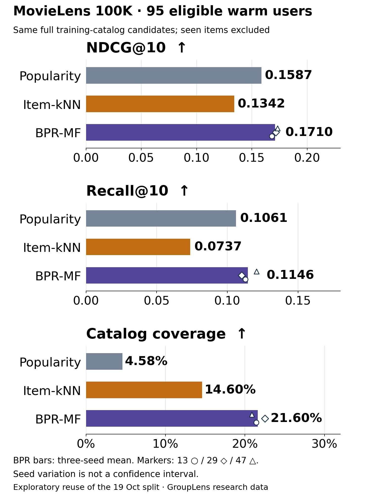

# Recommendation Explorer

A local workbench for recommender developers and product analysts: select liked
and seen items, compare BPR matrix factorization, item-neighborhood ranking and popularity,
inspect contributing history, then export the exact results as JSON or CSV.
No sign-in, paid key, telemetry or external inference service. This is a small
local research/demo app, not a hosted production recommendation service. Desktop
browser workflows and actual downloads were verified. The23 October BPR workflow
was also checked at390px width, with contained table scrolling, labelled controls
and keyboard submission; this is a targeted check, not a complete accessibility audit.

## Run

The23 October run used Python3.12.9, NumPy1.26.4, SciPy1.13.1,
PyTorch2.4.0(CPU), Matplotlib3.10.0. Earlier run versions remain in their saved results.

```sh
python -m venv .venv
# Activate .venv using your platform's activation command.
# CPU-only PyTorch avoids downloading CUDA dependencies on Linux.
python -m pip install torch==2.4.0 --index-url https://download.pytorch.org/whl/cpu
python -m pip install -r requirements.txt
python -m unittest -v
python app.py
```

Open http://127.0.0.1:8765. The default is an **authored synthetic catalog**, not
MovieLens data. Choose training-user profile `D00`, select **BPR matrix factorization**,
generate, switch to the other methods, then export JSON or CSV. All three methods
exclude the same past seen items. BPR fits locally at startup using fixed seed13;
that default was chosen before evaluation. It scores an existing fitted user and
does not personalize arbitrary new users. Custom anonymous histories support
item-kNN/popularity. Try liked `S01,S02`, other seen `S05`; generate, inspect contributor
scores, switch to popularity, then export. Clear the history to see the explicit
popularity fallback. An unknown ID gives a visible error and disables stale exports.

For your own appropriately licensed local CSV:

```sh
python app.py --data your-interactions.csv --port 8765
```

Exact header: `user,item,rating,timestamp`. IDs use ASCII letters/digits/._-;
ratings are finite1..5, timestamps nonnegative integer seconds. Repeated user-item
pairs are rejected: decide their aggregation policy before fitting. The app fits
all supplied rows; evaluation splitting is a separate benchmark command below.
Input is processed by the loopback-only Python server, never uploaded externally.
The current engine rejects >3000items or >500000rows before dense similarity
allocation. It is intended for small offline investigations. Model scores are
ranking signals, **not probabilities**, and differ in scale between methods.
BPR additionally caps training users at10000; it retains a dense seen-item mask
and is a small offline implementation. The app fits only the data explicitly
supplied to it; chronological evaluation uses the separate command below.

## 23 October addition: trained BPR factors and matched exports

An authored compact variant of established Bayesian Personalized Ranking now
fits32-dimensional user/item factors with a pairwise logistic objective. The
minibatch Adam optimizer, regularization and negative exclusion policy are
declared in[the frozen protocol](experiments/2026-10-23/PROTOCOL.md); this is not
an exact implementation or reproduction of the original paper's reported results.

The same exposed19 October MovieLens100K split and95 warm users were reused.
Baselines reproduced their saved metrics to1e-12. No hyperparameter sweep or
test-based checkpoint/seed selection was performed; all three fixed seeds remain.

| Warm-user primary task | Popularity | Item-kNN | BPR mean, seeds13/29/47 |
| --- | ---: | ---: | ---: |
| NDCG@10 |0.158664|0.134159|0.170954 |
| Recall@10 |0.106064|0.073715|0.114578 |
| Catalog coverage |4.58%|14.60%|21.60% |

BPR NDCG@10 was0.168067/0.171573/0.173222. The range is training-seed
variation, not a confidence interval. One warm user had no fitted positive
profile and used popularity. Another192 eligible cold users used popularity
and remain a separate cohort in the full[aggregate result](results/2026-10-23.json).
This modest result on a repeatedly exposed offline task is exploratory, not
independent validation, a click/revenue result or a general superiority claim.



```sh
python -m unittest -v
python benchmark_bpr.py --data /private/ml-100k/u.data --audit-dir /private/bpr-audit --output results/2026-10-23.json
python plot_bpr.py
```

Only code, authored demo data, aggregate results and figure sources are public.
All individual predictions and benchmark factors remain in the explicitly private
audit directory. The default synthetic app and the real-data research comparison
are distinct. Gradient finite differences, sampled-negative exclusion, unchanged
candidates/cohorts, model reload, API/export parity and native browser errors,
empty-history fallback, mobile layout and real download parity were checked.
CSV retains full-precision scores; the visible table rounds scores to6 decimals.

Method: Rendle, Freudenthaler, Gantner and Schmidt-Thieme,
[BPR: Bayesian Personalized Ranking from Implicit Feedback](https://arxiv.org/abs/1205.2618),
UAI2009; arXiv version posted9 May2012. No paper-reported metric is presented
as our experiment.

## The fixed19 October experiment: personalization lost this comparison

MovieLens100K, one global timestamp cutoff (1998-03-07T02:21:09Z),80003 past rows
and19997 strictly later rows. Candidate catalog:1616 training-observed items;
exclude every training-rated item, including disliked items. Rating>=4 defines
binary relevance. No candidate sampling or hyperparameter search.

| Primary cohort:95 eligible warm users | Popularity | Item-kNN |
| --- | ---: | ---: |
| Macro NDCG@10 |0.158664|0.134159|
| Macro Recall@10 |0.106064|0.073715|
| Catalog coverage |0.045792|0.146040|
| Unique recommended items |74|236|

Item-kNN reached more of the catalog but had worse observed-rating ranking metrics.
The negative result remains visible; the app does not silently choose it as winner.
There were192 additional eligible cold users, excluded from the primary cohort.
Over all287 eligible users, NDCG@10 was0.273642(popularity) versus0.265531(item-kNN).
Those different-cohort values cannot be directly compared with the warm-only values.
Item-kNN used popularity fallback for193all-cohort users, including one warm user.
Fourteen future users had no eligible positive, and95positive pairs involved items
outside the training catalog. All denominators and parameters are saved in
[results/2026-10-19.json](results/2026-10-19.json).


This session-oriented historical dataset has many cold users in a chronological
split. Results concern observed ratings, not randomized exposure, CTR, conversion,
retention gains or causal impact. There are no confidence intervals, tuning-based
claims or general model-superiority claims. The benchmark is development-visible
after the first run; subsequent checks/reuse are exploratory. See[PROTOCOL.md](PROTOCOL.md).

## Reproduce the research task

Read[GroupLens's terms](https://files.grouplens.org/datasets/movielens/ml-100k/README)
and obtain ml-100k locally from the provider. **Do not add it to this repository.**
Use a private folder outside the source checkout for u.data and individual audit:

```sh
python benchmark.py --data /private/ml-100k/u.data --audit-dir /private/recommendation-audit --output results/2026-10-19.json
python plot_results.py
```

The script verifies row count, strict temporal separation, candidate/seen-item
rules and saves a private per-user audit plus public aggregates/hashes. It reports
actual dependencies/hardware and run duration; duration is not a latency comparison.
Parameters were frozen before fitting. No benchmark-specific model or row-level
ratings/predictions are distributed. The app's synthetic demonstration is separate.

## Method and attribution

Binary positive-user co-occurrence, cosine similarity multiplied by c/(c+10),
20 strongest source neighbors per candidate column, then sum over liked history.
Self-similarity is zero. Ranking ties use popularity then lexical item ID. If all
candidate neighbor scores are zero, the app explicitly falls back to popularity.
This is an authored simple variant of established item-based collaborative filtering,
not the original paper's exact rating predictor, a novel algorithm or SOTA claim.

- Sarwar, Karypis, Konstan and Riedl(2001),[Item-based Collaborative Filtering Recommendation Algorithms](https://www.ra.ethz.ch/CDstore/www10/papers/519/), WWW2001, DOI10.1145/371920.372071.
- Harper and Konstan(2015),[The MovieLens Datasets: History and Context](https://doi.org/10.1145/2827872), ACM TiiS5(4), Article19. Dataset: GroupLens Research, University of Minnesota. No endorsement implied.
-[NDCG definition/reference](https://scikit-learn.org/stable/modules/generated/sklearn.metrics.ndcg_score.html). This repository implements its explicitly declared binary ranking metric directly.

Code and authored synthetic assets:MIT. MovieLens data retain their separate
research/noncommercial/no-redistribution conditions; this code's licence grants
no rights to those data. NumPy/SciPy/Matplotlib retain their respective licences.

## 26 October addition: an explicit sparse-history policy

[New feature and measured query-history experiment](experiments/2026-10-26/README.md):
compare popularity below3 unique positive items with an optional centroid of
learned item factors for longer histories, then export the chosen policy and
full-precision rankings. The threshold is declared and untuned. Results are mixed:
at full query history mean NDCG@10 was0.162093 versus popularity0.158664, while
Recall@10 fell to0.093074 versus0.106064. The same exposed95warm-user task and
three frozen model seeds were reused; this is not fresh independent validation.
The complete six-cap experiment, privacy-protected small-bin supports, diagrams,
runner, actual checks and limitations are linked above. The new policy is optional;
the default method is unchanged.
