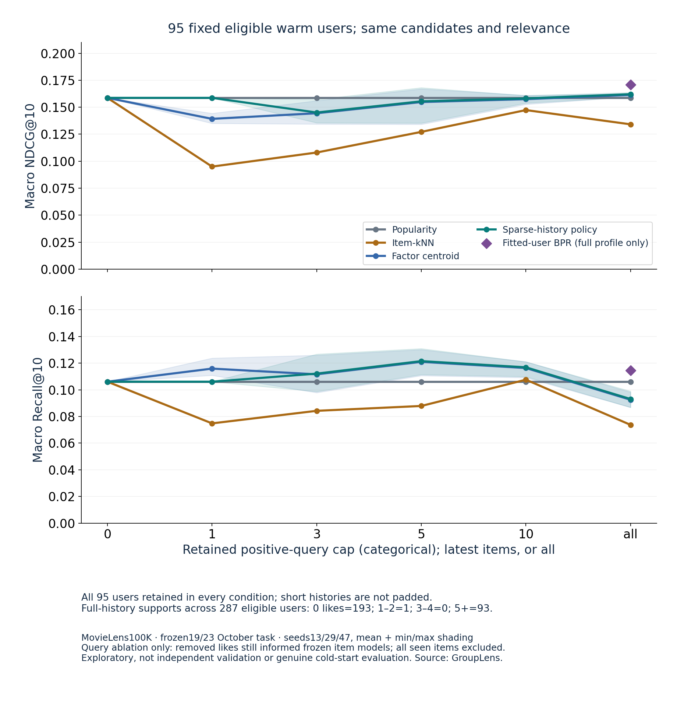
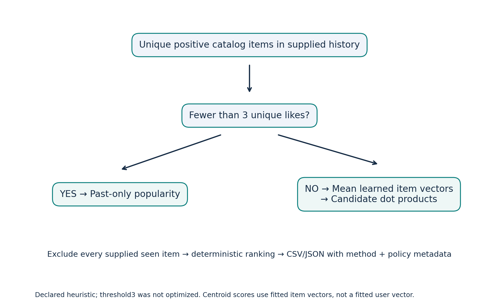

# Sparse-history policy and frozen-model query ablation

New26 October contribution to the existing Recommendation Explorer. Choose **Sparse-history policy (3 likes)** for a custom history or fitted synthetic profile. Fewer than3 unique positive catalog items use training popularity; otherwise average learned BPR item vectors and rank by candidate dot product. JSON/CSV include effective method, reason, unique history count and declared threshold. This centroid is an authored heuristic over learned item factors, **not BPR user inference**. The threshold was fixed before evaluation, remains unoptimized, and is an optional comparison method rather than the default or a production recommendation.

## Run the app

From the repository root, install the pinned requirements as in the main README, then:

```sh
python -m unittest -v
python app.py
```

Open http://127.0.0.1:8765. The no-sign-in example is authored synthetic data, trained locally with seed13, no paid API or external uploads. Choose the new sparse-history policy. Try likes `S01,S02`, other seen `S05`: popularity is explicitly shown. Change likes to `S01,S02,S03`: learned-factor centroid is shown. Generate and export JSON/CSV with full-precision scores and policy metadata. Select known profile`D00` to inspect its stored history. Unknown users without supplied history use explicit popularity through the API; unknown catalog items remain errors. Old BPR/item-kNN/popularity behavior remains available. A no-positive-training-pairs model falls back instead of using random vectors.

## Measured outcomes

All values below are macro averages on the **same95 eligible warm users**, then means over fixed item-factor seeds13/29/47. All individual seeds, seed ranges, Recall/NDCG, catalog coverage, fallback counts and supports remain in[the aggregate results](../../results/2026-10-26.json). No confidence intervals or runtime superiority claims.

| Query | Method | NDCG@10 | Recall@10 | Catalog coverage |
| --- | --- | ---: | ---: | ---: |
| At most1 latest positive | Popularity / sparse-history policy |0.158664|0.106064|0.045792|
| At most1 latest positive | Factor centroid |0.139219|0.115879|0.257013|
| All available positives | Popularity |0.158664|0.106064|0.045792|
| All available positives | Sparse-history policy |0.162093|0.093074|0.122937|
| All available positives | Item-kNN |0.134159|0.073715|0.146040|

The policy avoided the one-like centroid's lower NDCG by choosing popularity, while giving up its higher observed Recall and catalog coverage. With full query history the policy had slightly higher NDCG but lower Recall than popularity. This is mixed evidence, not an overall improvement. The previous fitted-user BPR reference remains stronger on full-profile mean NDCG(0.170954); it is shown only at full history because its learned user vector retains more information than truncated queries.

The natural-history supports across all287 eligible users are0likes:193(including192cold users),1-2:1,3-4:0,5+:93. That cannot establish that3 is an optimal threshold. Metrics for1..4-user public bins are suppressed by a uniform privacy rule, with supports retained; the local restricted audit preserves all outputs. See[PUBLICATION-PRIVACY.md](PUBLICATION-PRIVACY.md).




## Reproduce the experiment

Read[GroupLens research terms](https://files.grouplens.org/datasets/movielens/ml-100k/README), fetch the benchmark locally, then reproduce the original model checkpoints into a private directory using`benchmark_bpr.py`. Use the exact frozen23 October parameters, hashes and canonical ID mapping. Do not upload the data/checkpoints/audit.

```sh
python benchmark_bpr.py --data /private/ml-100k/u.data --audit-dir /private/bpr-audit --output /private/bpr-aggregate.json
python benchmark_history.py --data /private/ml-100k/u.data --prior-audit /private/bpr-audit --audit-dir /private/history-audit --output results/2026-10-26.json
python plot_history.py
```

This run reloaded the exact saved23 October factors, no new benchmark fit or seed selection. The original popularity/item-kNN and full-profile BPR reference metrics reproduce to1e-12. All three seeds, six query caps0/1/3/5/10/all and every method were retained. Source/data/split/factor hashes and actual CPU/dependency versions are saved. Runtime is an observed batch-run duration, not a matched latency benchmark. Run from the repository root. Row-level predictions stay in the private audit path; never put it inside Git.

## Limits and checks

The exact19/23 October global chronological task is already development-visible: **exploratory, not independent validation**. Models only use pre-cutoff rows; relevance and full train-catalog candidates remain fixed. Truncation retains the most recent positive query items. Removed likes still informed frozen item factors and similarities; original full seen history is retained solely for exclusion. This is a frozen-model query-history sensitivity test, not genuine cold-start generalization or retraining after event removal. Binary observed-rating relevance is not causal clicks, revenue, retention or business impact. There is no commercial MovieLens licence or endorsement.

Checks include independent scalar centroid and metric oracles, frozen split/factor hashes, complete original baseline reproduction, fixed candidates, no seen/duplicate output,2vs3 unique-like boundary, no hidden user-vector dependence, no learned-positive fallback, unknown/empty/all-seen inputs, API/export score parity, real browser JSON/CSV downloads, stale-export errors and keyboard generation. Native narrow-browser test observed487 CSS pixels after requesting390; no page horizontal overflow, but a390px device rendering was not verified. This is a targeted layout/keyboard/label/status check, not a full accessibility audit.

Code/synthetic demo assets:MIT. MovieLens retains separate restricted terms. Attribute GroupLens Research, University of Minnesota, and Harper & Konstan(2015), *The MovieLens Datasets: History and Context*, DOI10.1145/2827872. Prior BPR method: Rendle etal.,UAI2009, arXiv1205.2618v1. No scientific novelty or paper benchmark reproduction claim.
