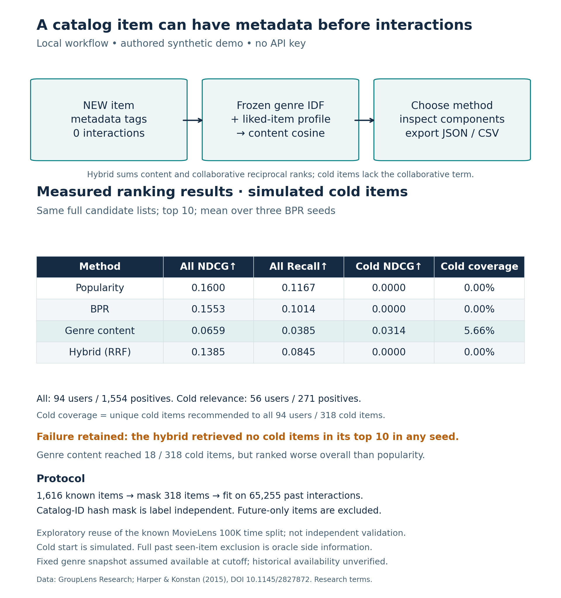

# Metadata-only catalog items: a working workflow and a failed hybrid

The new local CLI adds an item with **no interactions**, transforms its tags using
the already fitted genre-IDF model, and ranks it with content cosine. Inspect
content/collaborative components, cold-item flags and fallback reasons, then export
matching full-precision JSON/CSV. No API key, hosted demo or benchmark records.
Code and synthetic examples are MIT; MovieLens retains separate restrictive terms.

From repository root after installing requirements:

```sh
python catalog_cli.py --liked S01 --new-item '{"id":"NEW","tags":["space","adventure"]}' --method content --output /your/local/demo
python catalog_cli.py --liked S01 --new-item '{"id":"NEW","tags":["space","adventure"]}' --method hybrid --n 20
python -m unittest -v
```

For Windows PowerShell5, use the Python API below to avoid native JSON argument
quoting. All CLI workflows were also executed via Python subprocess argument lists.

```python
from bpr import BPRRecommender
from recommender import synthetic_rows
from catalog_model import CatalogModel, synthetic_catalog, catalog_csv
model = CatalogModel(BPRRecommender(synthetic_rows(), seed=13), synthetic_catalog())
model.add_item('NEW', ['space', 'adventure'])
result = model.recommend(liked=['S01'], method='content')
print(result)
print(catalog_csv(result))
```

Default inputs are independently authored synthetic interactions/tags. Existing
browser explorer remains available through app.py; the new catalog feature is a
CLI/API. For own appropriately licensed inputs, supply both --data
(user,item,rating,timestamp CSV) and --catalog (JSON item-ID → tag-list).
For a fitted user use --user-id instead of custom history. CLI training uses
seed13, not the best benchmark seed. It retrains on invocation; no latency claim.
Core caps:3000 items,500000 rows,10000 training users; not production scale.

New tags unseen by the fitted vocabulary are ignored. A zero metadata vector or
empty history triggers an explicit fallback. Scores are ranking signals, not
probabilities. Custom histories use mean warm-item BPR vectors; fitted profiles
use their trained user vectors. Metadata-only liked items can use content even
without collaborative representation. Adding an item does not refit IDF/BPR.

## Fixed evaluation, including the negative result

See [frozen protocol](PROTOCOL.md), [results](results.json), [checks](checks.json)
and [actual stdout](benchmark-stdout.txt). The known19/23/26October MovieLens100K
time split is reused, so these are exploratory results, not independent validation.
318 of1616 past-observed items were selected by a label-independent ID hash and
all14748 past interactions with them removed, leaving65255 fitting interactions.
No later interactions enter fitting. The full original past-seen exclusion is
kept as oracle side information. This is simulated missing interaction training,
not genuine item launch; provider genre snapshot availability at cutoff is assumed.

All four methods rank the same full catalog minus original seen history.
Primary cohort:94 users with retained training likes and eligible future positives;
1554 relevant pairs.207 other future users excluded;95 future-positive pairs are
outside the past catalog. BPR fits3 seeds13/29/47,30 epochs each, unchanged settings.

| Method | All NDCG@10 | All Recall@10 | Cold NDCG@10 | Cold coverage |
|---|---:|---:|---:|---:|
| Popularity |0.1600|0.1167|0|0%|
| BPR |0.1553|0.1014|0|0%|
| Genre content |0.0659|0.0385|0.0314|5.66%|
| Hybrid reciprocal ranks |0.1385|0.0845|0|0%|

Means over all3 seeds, no tuning. Genre model/popularity are deterministic and
identical across seeds; repetition does not provide independent uncertainty.
Cold metrics use56 users/271 positives; warm metrics use93 users/1283 positives.
Same original top10 rankings, evaluated against each subgroup's relevance,
not subgroup rerankings. Cohort metrics cannot be directly equated. Cold coverage
is18 distinct recommendations to the full94-user cohort divided by318 cold items.
Warm metrics and all per-seed outputs remain in results.json.

**The hybrid recommended no cold items in its top10 in any seed.** Its warm items
receive both reciprocal-rank terms while cold items receive only content. Content
can score cold items but lost overall ranking quality here. Popularity led the
overall comparison. We retain this failure and do not select new weights from
these inspected outputs. No commercial/data-rights, CTR/revenue/causal or deployment
claims. This feature exposes alternatives and their limitations. Seed spread
is not a confidence interval.



## Research reproduction and data rights

Read [GroupLens terms](https://files.grouplens.org/datasets/movielens/ml-100k/README),
download ml-100k.zip locally from the provider and keep it/audits OUTSIDE the public
tree. No data, titles, tag records, user IDs, factors or individual recommendations
are redistributed. Aggregate results/protocol/hashes only. MIT grants no rights
to MovieLens. Attribution: GroupLens Research, University of Minnesota; Harper &
Konstan(2015), The MovieLens Datasets: History and Context, DOI10.1145/2827872.

```sh
python benchmark_catalog.py --archive /private/ml-100k.zip --audit-dir /private/catalog-audit
python plot_catalog.py
```

protocol-frozen.json records the original fit's code hashes; use that code version
for exact reproduction. Saved restricted model replay matched1128 method outputs;
2916 subgroup metric rows were checked independently.62 meaningful local tests
passed; actual CLI workflow/error/export checks are in checks.json.

IDF formula/reference: [scikit-learn1.4.2 TfidfTransformer](https://scikit-learn.org/1.4/modules/generated/sklearn.feature_extraction.text.TfidfTransformer.html).
The rank fusion is an explicit untuned heuristic, not a new algorithm or claimed
exact paper reproduction. Plot motion is absent; diagram arrows are schematic.
