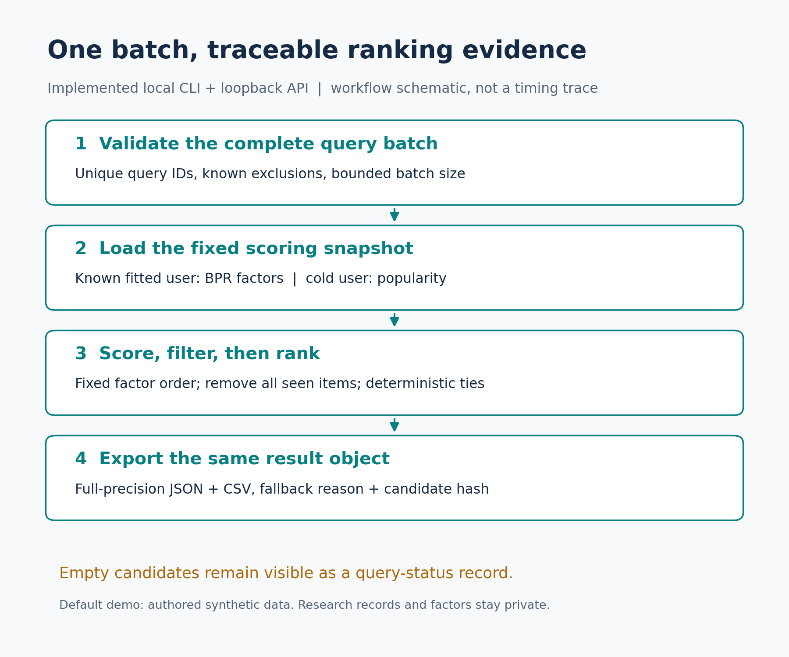
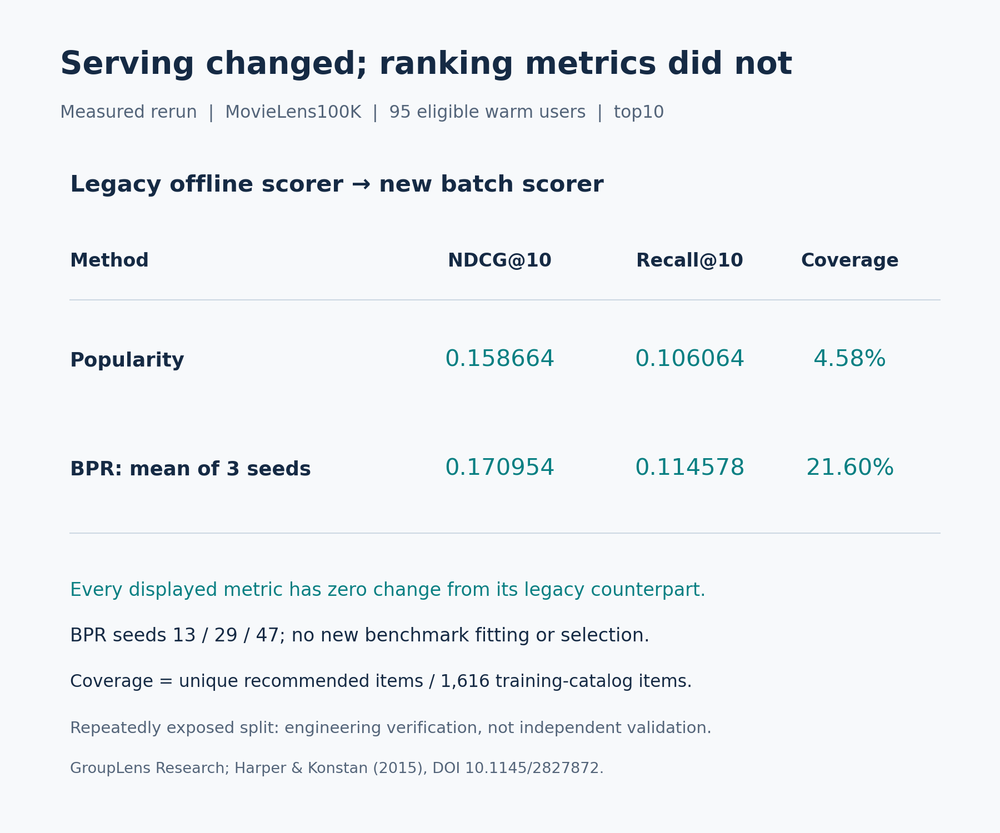
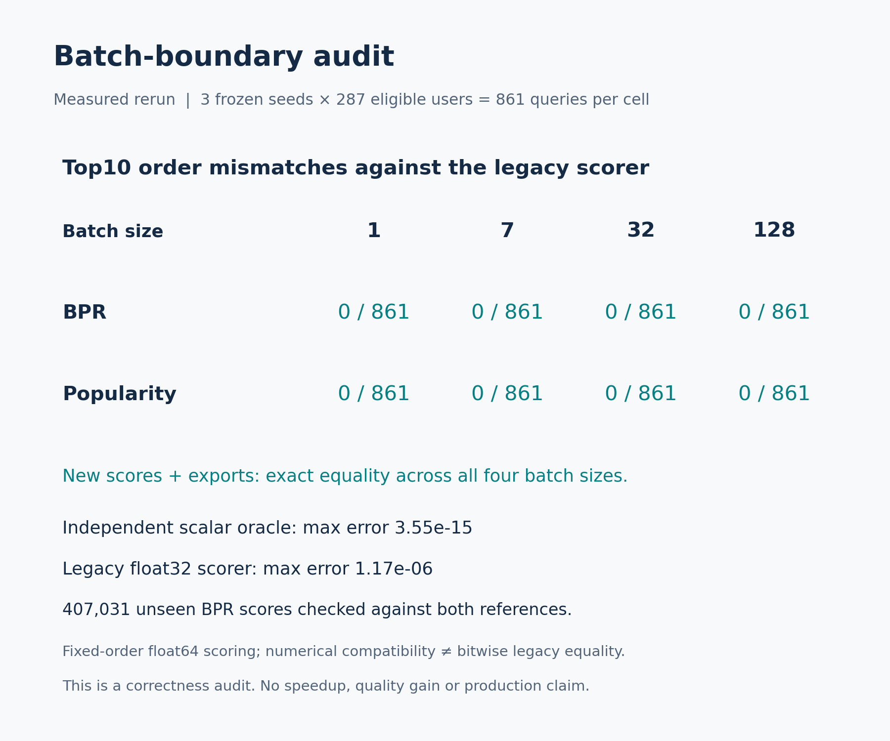

# A batch scoring-and-export path with checked ranking parity

New integration: `BatchServing` takes a startup snapshot of a fitted BPR model,
scores a validated batch, excludes all past seen items plus declared exclusions,
reports cold-user popularity fallback and exports the same result object to
JSON/CSV. The loopback server adds `POST /api/batch`; existing UI and single-query
routes remain available. The new batch workflow is documented CLI/API, not a new
browser interface or hosted demo. No paid key, telemetry or external inference.

## Run the safe default

Install the root requirements, then run from the repository root:

```sh
python -m unittest -v
python batch_cli.py --batch-size 7 --n 5 --output /your/local/fresh-batch
```

Choose a fresh output prefix; existing files are rejected. The actual default
workflow was executed and its [JSON](synthetic-demo/batch.json) is saved. It trains
seed13 on the independently authored synthetic interactions and serves four
queries: known profiles D00/D01, unknown NEW, and an anonymous query excluding S01.
The research benchmark factors and records are a separate private input.

To use your own appropriately licensed local interaction CSV, use `--data` with
the root README's schema/size limits. The CLI fits all explicitly supplied rows;
you must prepare a past-only training file for a temporal application. Add
`--queries queries.json` for a list such as:

```json
[
  {"query_id":"first","user_id":"D00","exclude":["S01"]},
  {"query_id":"new","user_id":"NEW"},
  {"query_id":"empty","exclude":["S01","S02","S03","S04","S05","S06","S07","S08","S09","S10","S11","S12"]}
]
```

This example uses only the authored catalog. Unknown valid users receive
popularity rather than fabricated personalized factors. Known users without
eligible fitted positives also fall back explicitly. This API does not fold in
custom likes for a new user; the existing history-policy workflow supports that
separate task. An empty eligible catalog returns `no_candidates` with a status
row in CSV, so a downstream consumer can distinguish empty from missing queries.

`python app.py` serves the existing local app and the new JSON endpoint:

```text
POST http://127.0.0.1:8765/api/batch
Content-Type: application/json
{"queries":[{"query_id":"first","user_id":"D00"},{"query_id":"new","user_id":"NEW"}],"method":"bpr","n":5,"batch_size":7}
```

The response embeds the exact CSV plus query results. All query IDs must be
unique; unknown item exclusions and malformed batches fail before scoring. Limits:
1–1000 queries, n1–100, scoring block1–128. The HTTP route also retains the
existing65536-byte request limit; CLI supports larger valid query files. These are
small offline tools, not a multi-tenant or production deployment.

## Executed evaluation

The [protocol](PROTOCOL.md) was hashed before execution. Three saved23October
BPR factor archives and original data/split hashes were verified; **zero new
benchmark fits**. Both methods, sizes1/7/32/128 and all287 eligible users give24
conditions and6,888 query results. Exactly zero legacy top10 order mismatches;
new score/status/rank results are exactly equal across batch sizes. Full-precision
CSV round trips and independent candidate/metric checks passed throughout.

For407,031 unseen fitted-user BPR scores, maximum absolute error versus an
independent Python `math.fsum` oracle was3.552713678800501e-15. Versus the prior
float32 matrix-vector scorer it was1.172212318323318e-6. These meet the prospectively
declared tolerances. Legacy scores are **not** bitwise equal to the new float64
scores; a nearly tied rank can still differ on another input. Exact parity here
is an observed outcome, not a universal ranking theorem.

|95 warm-user primary cohort|Popularity|BPR mean of seeds13/29/47|
|---|---:|---:|
|NDCG@10|0.158664|0.170954|
|Recall@10|0.106064|0.114578|
|Catalog coverage|4.58%|21.60%|

All values have zero change from their saved legacy counterparts. BPR warm
NDCG@10 across seeds was0.168067–0.173222, a descriptive range, not a confidence
interval. The192 cold users remain separately reported. The factor request falls
back for those192 users plus one warm profile.14 future users without eligible
positives and95 future-positive pairs outside the training catalog remain excluded.
Coverage denominator is1616 training items. Candidate availability and seen-item
rules match the prior evaluator; no future labels enter the model or filters.

The [full aggregate results](results.json), actual stdout and
[checks](checks.json) retain all conditions.83 local tests passed, including12 new
batch tests: independent scores, exact/near ties, candidate exclusions, fallback,
empty-candidate export, actual CLI files and overwrite rejection, and HTTP success
and invalid input. No benchmark speed comparison was performed.





## Reproduce with licensed research inputs

Fetch MovieLens100K from GroupLens locally; obtain the existing frozen factors by
rerunning the23October fit protocol with the same dependencies. Verify all hashes
against results/2026-10-23.json. Data/factors do not belong in this public repo.

```sh
python benchmark_batch.py --data /private/ml-100k/u.data --factors /private/original-bpr-audit --audit /private/batch-audit --output experiments/2026-11-04/results.json
python plot_batch.py
```

This repeatedly exposed historical task is exploratory engineering verification,
not independent quality validation, online satisfaction or causal business impact.
No new model, speedup, SOTA or scientific novelty claim. The contribution is the
working integration and measured consistency, not improved prediction quality.

MovieLens: GroupLens Research, University of Minnesota; Harper and Konstan2015,
*The MovieLens Datasets: History and Context*, DOI10.1145/2827872. Provider research
terms prohibit redistribution without permission and require separate commercial
permission. Public artifacts contain authored code/synthetic examples, hashes and
aggregates only. No provider rows, item catalog, per-user research rankings or
research factors. Code/assets are MIT; source methods/data retain their own credit
and terms. See [source ledger](source-ledger.json).
