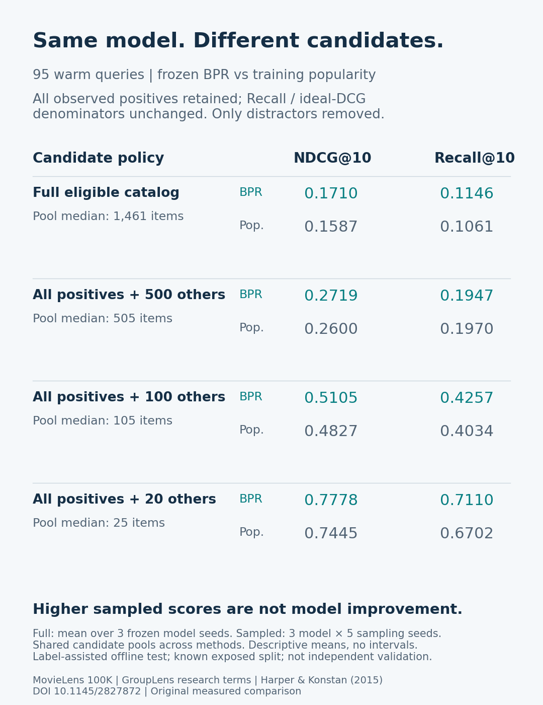

# Candidate sampling changes the evaluation task

This executed local research comparison keeps three existing BPR models frozen and changes only the offline evaluation candidate policy. It adds no app feature and makes no model-quality, speed, commercial-use or scientific-novelty claim.

## Reproduce

Run from the repository root with Python3.12.9 and the pinned requirements. Download MovieLens100K directly from GroupLens for permitted local research, read its terms, and keep it outside the checkout. No paid key is needed. The provider forbids redistribution without permission; commercial use requires separate permission. Do not upload ratings, provider item/user records, benchmark factors or query-level audits.

The original factor archives were generated by `benchmark_bpr.py` on 23 October. They are not publicly redistributed. For a fresh local reproduction, fetch the provider archive, unpack it locally, run the original benchmark with the existing frozen settings, then run this comparison using those locally generated factors:

```text
python -m pip install -r requirements.txt
python benchmark_bpr.py --data ../local-movielens/u.data --audit-dir ../local-original-factors --output ../local-original-results.json
python benchmark_candidates.py --data ../local-movielens/u.data --factors ../local-original-factors --audit ../local-candidate-audit --output ../local-candidate-results.json
python -m unittest test_candidates -v
python plot_candidates.py
```

This comparison intentionally verifies the original data/partition/factor hashes before evaluating. A mismatched archive is a blocked reproduction, not permission to silently substitute a new trained model. Inspect your recorded dependency versions and original run before drawing comparisons. `plot_candidates.py` reads the checked-in aggregate result; point it at newly reproduced results only after inspecting them. Use fresh output/audit paths: existing files/directories are protected. The CLI never trains or tunes a model. The full original BPR training procedure and its historical limitations remain documented in the root README and October23protocol.

## Frozen design

See `PROTOCOL.md` and its pre-execution hash receipt. MovieLens100K chronological cutoff889237269 yields80,003past and19,997future interactions. Existing training catalog:1,616items. Relevance is an observed future rating>=4 for a catalog item never rated by that user in the past. Known evaluation task, repeatedly exposed since19October: exploratory, not independent validation.

Primary cohort:95eligible warm queries; secondary192cold queries; all287retained.14future users without eligible relevance and95future-positive pairs outside the training catalog remain outside this task. A warm query without a fitted positive BPR profile uses the explicit popularity fallback (one warm query). Cold users also fall back. Training-only popularity counts positive users per item.

Conditions: full eligible catalog versus every observed relevant item plus20,100or500uniformly sampled other eligible items, without replacement. Sampling seeds101,202,303,404,505; prefixes of the same per-user permutation make pools nested. Identical pools are shared by BPR/popularity and all three frozen model seeds13,29,47. Sampled pools use future labels to retain positives: they are a label-assisted offline evaluation construction, not a deployable candidate generator. Unobserved items are not known dislikes.

All observed positives remain, so each query's Recall denominator and ideal binaryDCG denominator stay fixed. Candidate-pool size/distribution changes. This is not the same ranking task as full-catalog evaluation. Scores use the existing November4fixed-order float64 accumulation; ties break by training popularity then ASCII item ID. No retraining, parameter selection or sampling-seed selection occurs.

## Actual primary results

Means over all prespecified conditions. Full uses3frozen BPR seeds; sampled uses3model seeds ×5sampling seeds. Popularity is repeated for matched comparisons, not15independent models. Complete per-condition values, ranges, support counts and cold/all cohorts are retained in `results.json`.

| Candidate policy | Median pool | BPR NDCG@10 | Pop. NDCG@10 | BPR Recall@10 | Pop. Recall@10 |
| --- | ---: | ---: | ---: | ---: | ---: |
| Full eligible catalog |1461|0.1710|0.1587|0.1146|0.1061|
| All observed positives +500others |505|0.2719|0.2600|0.1947|0.1970|
| All observed positives +100others |105|0.5105|0.4827|0.4257|0.4034|
| All observed positives +20others |25|0.7778|0.7445|0.7110|0.6702|

The full-catalog pool ranges1,008–1,615items per warm query; +20ranges21–212because users have different observed-positive counts. Total warm relevant pairs stay1,571; cold relevant pairs stay9,637in every condition. No candidate-size or support change is hidden by the average. The BPR–popularity Recall ordering differs in the500sample condition (popularity0.1970 versus BPR0.1947); NDCG still favors BPR in the reported mean. Neither method improved its fitted parameters.



## Evidence and limitations

96conditions and27,552query results completed.9new checks and92total repository checks passed. All query metrics were checked against an independently written scalar DCG/recall oracle. Exact pools, exclusion of seen items, nested sampling, preserved positives/supports, identical cross-model candidate hashes, unchanged factor arrays and lossless JSON/CSV roundtrips were checked. Full-catalog warm metrics reproduced the prior November4results within1e-12. The actual existing-output protection case exited nonzero without overwriting results. Raw public-safe stdout and compact checks are included.

Private audit files contain candidate membership, per-query rankings/scores and hashes and are deliberately excluded from GitHub. Public aggregate results retain their SHA256 hashes. This is a small historical, repeatedly exposed benchmark with observed feedback and a label-assisted offline sampler. Acrossseed ranges are descriptive, not confidence intervals. There is no claim about live satisfaction, revenue, true negative labels, production candidate generation or a universally superior method.

## Sources and credit

- GroupLens Research, University of Minnesota. MovieLens100K provider README, terms checked9November2026: https://files.grouplens.org/datasets/movielens/ml-100k/README . Harper andKonstan2015, *The MovieLens Datasets: History and Context*, DOI10.1145/2827872.
- Krichene andRendle2020, *On Sampled Metrics for Item Recommendation*, KDD2020, DOI10.1145/3394486.3403226. Official author page: https://research.google/pubs/on-sampled-metrics-for-item-recommendation/ . Published IJCAI2021extended abstract: https://ijcai.org/proceedings/2021/651 . Established sampling concern; this multi-positive local experiment is not an exact reproduction of their single-positive analysis or corrected estimators.
- Existing owner code and factor provenance: immutable parent39a57b5d20a805d4a398b8696f266bb76ad4336e, October23factor hashes and November4batch scorer/results. New source and original figure use the repository's MIT licence; preserve existing human/dependency credit. Provider data retains its separate restrictions.
